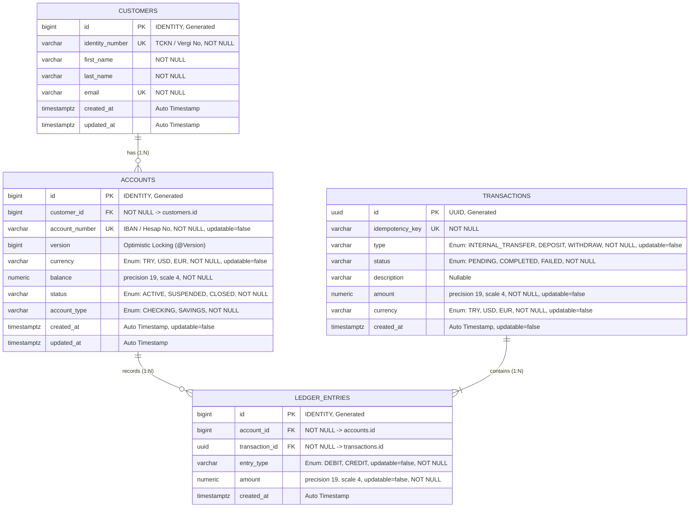
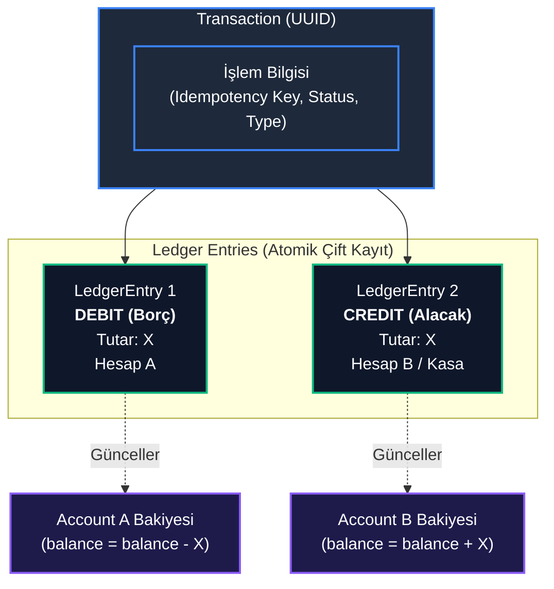

# 🏦 Core Banking Ledger - Veritabanı ve Entity İlişki Şeması

Bu doküman, `core-banking-ledger` (banking-v1) projesinde yer alan JPA Entity sınıfları, enum türleri, veritabanı tabloları, aralarındaki kardinalite ilişkileri ve PostgreSQL üzerinde oluşacak fiziksel şemayı ayrıntılı olarak belgelemektedir.

---

## 1. 📌 Varlık-İlişki (Entity-Relationship) Şeması

Aşağıdaki Mermaid ER diyagramı; entity'ler arasındaki bire-çok (1:N) ilişkileri, birincil anahtarları (PK), yabancı anahtarları (FK) ve alan kısıtlarını görselleştirmektedir:



---

## 2. 🏛️ Çift Taraflı Muhasebe (Double-Entry) Akış Şeması

Bankacılık defterinde her finansal işlem (`Transaction`), borç ve alacak dengesini sağlamak için en az iki adet değişmez (`immutable`) defter satırı (`LedgerEntry`) üretir:



$$\sum DEBIT = \sum CREDIT$$

---

## 3. 📋 Tablo Detayları (Data Dictionary)

### 3.1. `customers` Tablosu
Müşteri kimlik ve profil bilgilerini saklar.

| Kolon Adı | JPA / Java Alanı | PostgreSQL Veri Tipi | Kısıtlar (Constraints) | Açıklama |
| :--- | :--- | :--- | :--- | :--- |
| `id` | `Long id` | `BIGINT` | `PRIMARY KEY`, `GENERATED BY DEFAULT AS IDENTITY` | Benzersiz müşteri ID |
| `identity_number` | `String identityNumber` | `VARCHAR(255)` | `NOT NULL`, `UNIQUE` | TCKN veya Vergi Kimlik Numarası |
| `first_name` | `String firstName` | `VARCHAR(255)` | `NOT NULL` | Müşteri adı |
| `last_name` | `String lastName` | `VARCHAR(255)` | `NOT NULL` | Müşteri soyadı |
| `email` | `String email` | `VARCHAR(255)` | `NOT NULL`, `UNIQUE` | Müşteri e-posta adresi |
| `created_at` | `Instant createdAt` | `TIMESTAMPTZ` | `@CreationTimestamp` | Kayıt oluşturulma zamanı |
| `updated_at` | `Instant updatedAt` | `TIMESTAMPTZ` | `@UpdateTimestamp` | Son güncellenme zamanı |

---

### 3.2. `accounts` Tablosu
Müşterilere ait banka hesaplarını, anlık bakiyeyi ve eşzamanlılık (concurrency) versiyonunu saklar.

| Kolon Adı | JPA / Java Alanı | PostgreSQL Veri Tipi | Kısıtlar (Constraints) | Açıklama |
| :--- | :--- | :--- | :--- | :--- |
| `id` | `Long id` | `BIGINT` | `PRIMARY KEY`, `GENERATED BY DEFAULT AS IDENTITY` | Benzersiz hesap ID |
| `customer_id` | `Customer customer` | `BIGINT` | `NOT NULL`, `REFERENCES customers(id)` | Hesabın ait olduğu müşteri (FK) |
| `account_number` | `String accountNumber` | `VARCHAR(255)` | `NOT NULL`, `UNIQUE`, `UPDATABLE = FALSE` | IBAN veya Hesap Numarası |
| `version` | `Long version` | `BIGINT` | `DEFAULT 0` | `@Version` ile Optimistic Lock kontrolü |
| `currency` | `Currency currency` | `VARCHAR(255)` | `NOT NULL`, `UPDATABLE = FALSE` | Para birimi (`TRY`, `USD`, `EUR`) |
| `balance` | `BigDecimal balance` | `NUMERIC(19, 4)` | `NOT NULL` | Hesap bakiyesi (4 basamak hassasiyet) |
| `status` | `AccountStatus status` | `VARCHAR(255)` | `NOT NULL` | Hesap durumu (`ACTIVE`, `SUSPENDED`, `CLOSED`) |
| `account_type` | `AccountType accountType` | `VARCHAR(255)` | `NOT NULL` | Hesap türü (`CHECKING`, `SAVINGS`) |
| `created_at` | `Instant createdAt` | `TIMESTAMPTZ` | `@CreationTimestamp`, `UPDATABLE = FALSE` | Hesap açılış zamanı |
| `updated_at` | `Instant updatedAt` | `TIMESTAMPTZ` | `@UpdateTimestamp` | Son hesap güncelleme zamanı |

---

### 3.3. `transactions` Tablosu
Her bir transfer, para yatırma veya çekme operasyonunun ana işlem üst kaydıdır (Idempotency ve üst durum yönetimi).

| Kolon Adı | JPA / Java Alanı | PostgreSQL Veri Tipi | Kısıtlar (Constraints) | Açıklama |
| :--- | :--- | :--- | :--- | :--- |
| `id` | `UUID id` | `UUID` | `PRIMARY KEY` | Benzersiz işlem UUID değeri |
| `idempotency_key`| `String idempotencyKey` | `VARCHAR(255)` | `NOT NULL`, `UNIQUE` | Ağ tekrarlarını önleyici istemci anahtarı |
| `type` | `TransactionType type` | `VARCHAR(255)` | `NOT NULL`, `UPDATABLE = FALSE` | `INTERNAL_TRANSFER`, `DEPOSIT`, `WITHDRAW` |
| `status` | `TransactionStatus status` | `VARCHAR(255)` | `NOT NULL` | `PENDING`, `COMPLETED`, `FAILED` |
| `description` | `String description` | `VARCHAR(255)` | `NULLABLE` | İşlem açıklaması |
| `amount` | `BigDecimal amount` | `NUMERIC(19, 4)` | `NOT NULL`, `UPDATABLE = FALSE` | Talep edilen işlem tutarı |
| `currency` | `Currency currency` | `VARCHAR(255)` | `NOT NULL`, `UPDATABLE = FALSE` | İşlem para birimi (`TRY`, `USD`, `EUR`) |
| `created_at` | `Instant createdAt` | `TIMESTAMPTZ` | `@CreationTimestamp`, `UPDATABLE = FALSE` | İşlem oluşturulma zamanı |

---

### 3.4. `ledger_entries` Tablosu
Çift taraflı muhasebe defter kayıtlarıdır. **Yalnızca ekleme yapılabilir (Append-only / Immutable)**; finansal bütünlük gereği `updatable = false` kuralına sahiptir.

| Kolon Adı | JPA / Java Alanı | PostgreSQL Veri Tipi | Kısıtlar (Constraints) | Açıklama |
| :--- | :--- | :--- | :--- | :--- |
| `id` | `Long id` | `BIGINT` | `PRIMARY KEY`, `GENERATED BY DEFAULT AS IDENTITY` | Defter satır ID |
| `account_id` | `Account account` | `BIGINT` | `NOT NULL`, `REFERENCES accounts(id)` | İlgili hesap (FK) |
| `transaction_id` | `Transaction transaction`| `UUID` | `NOT NULL`, `REFERENCES transactions(id)` | Bağlı olduğu işlem (FK) |
| `entry_type` | `EntryType entryType` | `VARCHAR(255)` | `NOT NULL`, `UPDATABLE = FALSE` | Hareket türü (`DEBIT`, `CREDIT`) |
| `amount` | `BigDecimal amount` | `NUMERIC(19, 4)` | `NOT NULL`, `UPDATABLE = FALSE` | Hareket tutarı (pozitif değer) |
| `created_at` | `Instant createdAt` | `TIMESTAMPTZ` | `@CreationTimestamp` | Defter kaydı oluşturulma zamanı |

---

## 4. 🔗 İlişkiler ve Kardinalite Analizi (JPA Mapping)

### 4.1. `Customer` ⟷ `Account` (1:N)
* **İlişki Tipi:** Bir müşterinin birden çok hesabı olabilir (`One-to-Many`), bir hesap tek bir müşteriye aittir (`Many-to-One`).
* **İlişki Sahibi (Owner):** `Account` entity'si (`@JoinColumn(name = "customer_id", nullable = false)`).
* **Ters Yön:** `Customer.accounts` koleksiyonu (`@OneToMany(mappedBy = "customer")`).
* **Fetch Stratejisi:** `Account` tarafında `FetchType.LAZY` (N+1 problemini önlemek ve gereksiz yükten kaçınmak için ideal).

### 4.2. `Account` ⟷ `LedgerEntry` (1:N)
* **İlişki Tipi:** Bir hesapta yüzlerce defter hareketi bulunabilir (`One-to-Many`), her defter hareketi tek bir hesabı etkiler (`Many-to-One`).
* **İlişki Sahibi (Owner):** `LedgerEntry` entity'si (`@JoinColumn(name = "account_id", nullable = false)`).
* **Ters Yön:** `Account.ledgerEntries` koleksiyonu (`@OneToMany(mappedBy = "account")`).
* **Fetch Stratejisi:** `LedgerEntry` tarafında `FetchType.LAZY`.

### 4.3. `Transaction` ⟷ `LedgerEntry` (1:N)
* **İlişki Tipi:** Bir işlem üst başlığı, borç ve alacak olmak üzere defter satırlarını kapsar (`One-to-Many`).
* **İlişki Sahibi (Owner):** `LedgerEntry` entity'si (`@JoinColumn(name = "transaction_id", nullable = false)`).
* **Ters Yön:** `Transaction.ledgerEntries` koleksiyonu (`@OneToMany(mappedBy = "transaction", cascade = CascadeType.ALL)`).
* **Cascade Davranışı:** `CascadeType.ALL` kullanılmıştır. Bir transfer tamamlandığında bağlı olan `LedgerEntry` kayıtları işlem ile birlikte atomik olarak kaydedilir.

---

## 5. 🗄️ PostgreSQL DDL Şeması (Fiziksel SQL Karşılığı)

Aşağıdaki SQL scripti; Hibernate'in oluşturduğu şemayı ve kurumsal bankacılık için önerilen **CHECK constraint** ve **indeksleri** içermektedir:

```sql
-- 1. Customers Tablosu
CREATE TABLE customers (
    id BIGINT GENERATED BY DEFAULT AS IDENTITY PRIMARY KEY,
    identity_number VARCHAR(255) NOT NULL,
    first_name VARCHAR(255) NOT NULL,
    last_name VARCHAR(255) NOT NULL,
    email VARCHAR(255) NOT NULL,
    created_at TIMESTAMPTZ,
    updated_at TIMESTAMPTZ,
    CONSTRAINT uk_customers_identity_number UNIQUE (identity_number),
    CONSTRAINT uk_customers_email UNIQUE (email)
);

-- 2. Accounts Tablosu
CREATE TABLE accounts (
    id BIGINT GENERATED BY DEFAULT AS IDENTITY PRIMARY KEY,
    customer_id BIGINT NOT NULL,
    account_number VARCHAR(255) NOT NULL,
    version BIGINT DEFAULT 0,
    currency VARCHAR(255) NOT NULL,
    balance NUMERIC(19, 4) NOT NULL,
    status VARCHAR(255) NOT NULL,
    CONSTRAINT uk_accounts_account_number UNIQUE (account_number),
    CONSTRAINT fk_accounts_customer FOREIGN KEY (customer_id) REFERENCES customers (id),
    CONSTRAINT chk_accounts_balance_non_negative CHECK (balance >= 0) -- Finansal güvence
);

-- 3. Transactions Tablosu
CREATE TABLE transactions (
    id UUID PRIMARY KEY,
    idempotency_key VARCHAR(255) NOT NULL,
    type VARCHAR(255) NOT NULL,
    status VARCHAR(255) NOT NULL,
    description VARCHAR(255),
    created_at TIMESTAMPTZ,
    CONSTRAINT uk_transactions_idempotency_key UNIQUE (idempotency_key)
);

-- 4. Ledger Entries Tablosu
CREATE TABLE ledger_entries (
    id BIGINT GENERATED BY DEFAULT AS IDENTITY PRIMARY KEY,
    account_id BIGINT NOT NULL,
    transaction_id UUID NOT NULL,
    entry_type VARCHAR(255) NOT NULL,
    amount NUMERIC(19, 4) NOT NULL,
    created_at TIMESTAMPTZ,
    CONSTRAINT fk_ledger_entries_account FOREIGN KEY (account_id) REFERENCES accounts (id),
    CONSTRAINT fk_ledger_entries_transaction FOREIGN KEY (transaction_id) REFERENCES transactions (id),
    CONSTRAINT chk_ledger_entries_amount_positive CHECK (amount > 0) -- Defter tutarı daima > 0
);

-- ==========================================
-- Önerilen Performans İndeksleri (Indexes)
-- ==========================================
CREATE INDEX idx_accounts_customer_id ON accounts(customer_id);
CREATE INDEX idx_ledger_entries_account_id ON ledger_entries(account_id);
CREATE INDEX idx_ledger_entries_transaction_id ON ledger_entries(transaction_id);
CREATE INDEX idx_ledger_entries_created_at ON ledger_entries(created_at);
```

---

## 6. 💡 Mimari Notlar ve Gözlemler

1. **`AccountType` Enum Durumu:**
   * Projede `com.akt.banking_v1.enums.AccountType` (`CHECKING`, `SAVINGS`) enum sınıfı tanımlanmıştır.
   * Ancak şu anki `Account` entity sınıfında `accountType` alanı henüz yer almamaktadır. Vadeli/Vadesiz hesap ayrımı yapılacaksa `Account` modeline eklenmesi önerilir.

2. **Idempotency Stratejisi:**
   * `Transaction` entity'sinde `idempotencyKey` kolonu `unique = true` kısıtı ile bulunmaktadır. Bu sayede mükerrer transfer istekleri veritabanı seviyesinde `DataIntegrityViolationException` ile engellenir.
   * Şartnamede geçen opsiyonel `IdempotencyRecord` (HTTP yanıt payload'ı saklama) ihtiyacı doğarsa, ayrı bir tablo olarak sisteme dahil edilebilir.

3. **Eşzamanlılık ve Kilit Mekanizması:**
   * `Account` entity'sindeki `@Version private Long version;` alanı **Optimistic Locking** sağlar.
   * Yüksek frekanslı transferlerde Deadlock önlemek için servis katmanında hesap ID'lerinin küçükten büyüğe sıralanarak **Pessimistic Locking** (`SELECT ... FOR UPDATE`) ile kilitlenmesi mimari şartnamede hedeflenmiştir.
