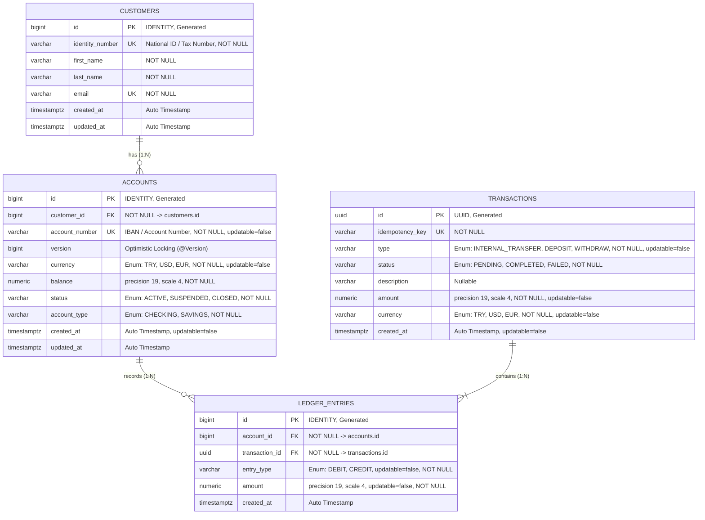
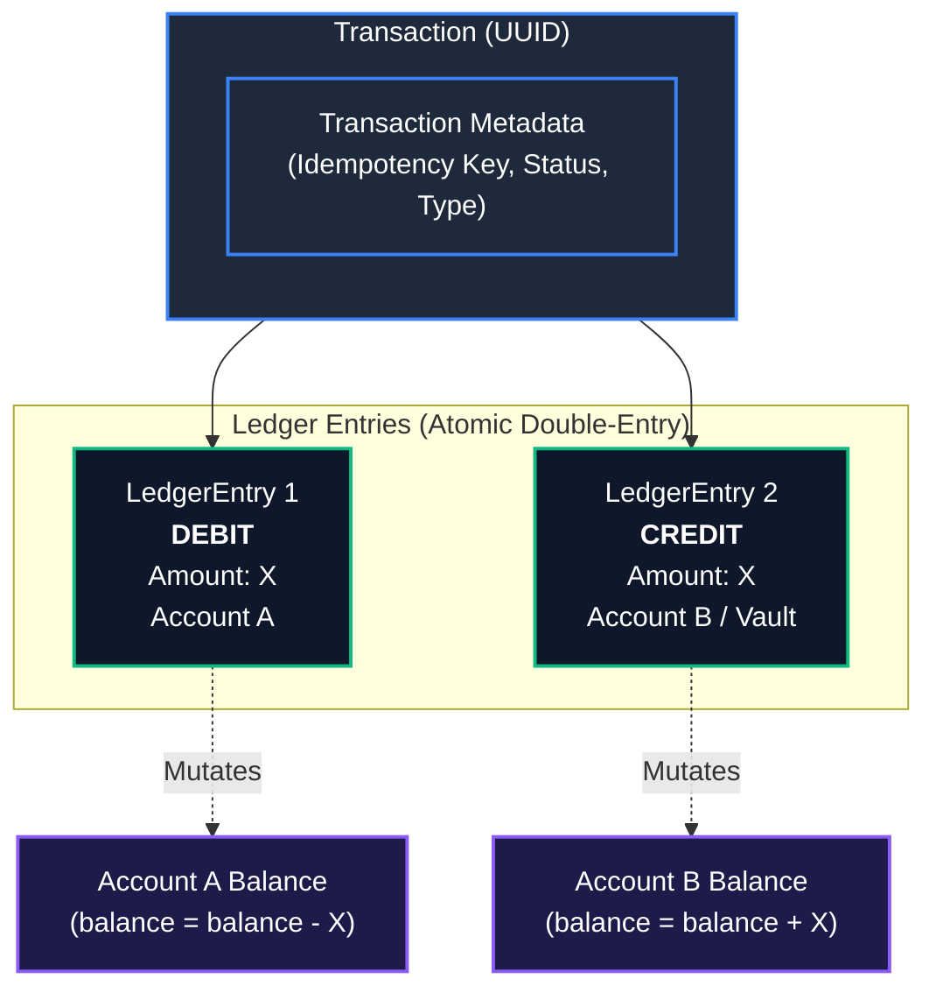

# 🏦 Core Banking Ledger - Database & Entity-Relationship Schema

This document details the JPA Entity classes, enum types, database tables, cardinality relationships, and the physical PostgreSQL schema for the `core-banking-ledger` (banking-v1) project.

---

## 1. 📌 Entity-Relationship (ER) Schema

The following Mermaid ER diagram visualizes the one-to-many (1:N) relationships, primary keys (PK), foreign keys (FK), and column constraints between entities:



---

## 2. 🏛️ Double-Entry Bookkeeping Flow

In a banking ledger, every financial transaction (`Transaction`) produces at least two immutable ledger entries (`LedgerEntry`) to maintain debit and credit equilibrium:



$$\sum \text{DEBIT} = \sum \text{CREDIT}$$

---

## 3. 📋 Data Dictionary

### 3.1. `customers` Table
Stores customer identity and profile credentials.

| Column Name | JPA / Java Field | PostgreSQL Data Type | Constraints | Description |
| :--- | :--- | :--- | :--- | :--- |
| `id` | `Long id` | `BIGINT` | `PRIMARY KEY`, `GENERATED BY DEFAULT AS IDENTITY` | Unique customer surrogate ID |
| `identity_number` | `String identityNumber` | `VARCHAR(255)` | `NOT NULL`, `UNIQUE` | National Identity Number or Tax ID |
| `first_name` | `String firstName` | `VARCHAR(255)` | `NOT NULL` | Customer first name |
| `last_name` | `String lastName` | `VARCHAR(255)` | `NOT NULL` | Customer last name |
| `email` | `String email` | `VARCHAR(255)` | `NOT NULL`, `UNIQUE` | Customer email address |
| `created_at` | `Instant createdAt` | `TIMESTAMPTZ` | `@CreationTimestamp` | Record creation timestamp |
| `updated_at` | `Instant updatedAt` | `TIMESTAMPTZ` | `@UpdateTimestamp` | Last modification timestamp |

---

### 3.2. `accounts` Table
Stores bank accounts associated with customers, real-time balances, and concurrency lock versions.

| Column Name | JPA / Java Field | PostgreSQL Data Type | Constraints | Description |
| :--- | :--- | :--- | :--- | :--- |
| `id` | `Long id` | `BIGINT` | `PRIMARY KEY`, `GENERATED BY DEFAULT AS IDENTITY` | Unique account surrogate ID |
| `customer_id` | `Customer customer` | `BIGINT` | `NOT NULL`, `REFERENCES customers(id)` | Associated customer (FK) |
| `account_number` | `String accountNumber` | `VARCHAR(255)` | `NOT NULL`, `UNIQUE`, `UPDATABLE = FALSE` | IBAN or Account Number |
| `version` | `Long version` | `BIGINT` | `DEFAULT 0` | Optimistic lock control via `@Version` |
| `currency` | `Currency currency` | `VARCHAR(255)` | `NOT NULL`, `UPDATABLE = FALSE` | Account currency (`TRY`, `USD`, `EUR`) |
| `balance` | `BigDecimal balance` | `NUMERIC(19, 4)` | `NOT NULL` | Account balance (4 decimal places precision) |
| `status` | `AccountStatus status` | `VARCHAR(255)` | `NOT NULL` | Account status (`ACTIVE`, `SUSPENDED`, `CLOSED`) |
| `account_type` | `AccountType accountType` | `VARCHAR(255)` | `NOT NULL` | Account type (`CHECKING`, `SAVINGS`) |
| `created_at` | `Instant createdAt` | `TIMESTAMPTZ` | `@CreationTimestamp`, `UPDATABLE = FALSE` | Account opening timestamp |
| `updated_at` | `Instant updatedAt` | `TIMESTAMPTZ` | `@UpdateTimestamp` | Last update timestamp |

---

### 3.3. `transactions` Table
Master transaction header for transfer, deposit, or withdrawal operations (idempotency barrier and status management).

| Column Name | JPA / Java Field | PostgreSQL Data Type | Constraints | Description |
| :--- | :--- | :--- | :--- | :--- |
| `id` | `UUID id` | `UUID` | `PRIMARY KEY` | Unique transaction UUID |
| `idempotency_key`| `String idempotencyKey` | `VARCHAR(255)` | `NOT NULL`, `UNIQUE` | Client-provided idempotency key preventing network retries |
| `type` | `TransactionType type` | `VARCHAR(255)` | `NOT NULL`, `UPDATABLE = FALSE` | `INTERNAL_TRANSFER`, `DEPOSIT`, `WITHDRAW` |
| `status` | `TransactionStatus status` | `VARCHAR(255)` | `NOT NULL` | `PENDING`, `COMPLETED`, `FAILED` |
| `description` | `String description` | `VARCHAR(255)` | `NULLABLE` | Transaction narrative / description |
| `amount` | `BigDecimal amount` | `NUMERIC(19, 4)` | `NOT NULL`, `UPDATABLE = FALSE` | Requested transaction amount |
| `currency` | `Currency currency` | `VARCHAR(255)` | `NOT NULL`, `UPDATABLE = FALSE` | Transaction currency (`TRY`, `USD`, `EUR`) |
| `created_at` | `Instant createdAt` | `TIMESTAMPTZ` | `@CreationTimestamp`, `UPDATABLE = FALSE` | Transaction creation timestamp |

---

### 3.4. `ledger_entries` Table
Double-entry bookkeeping financial records. **Append-only and immutable**; enforces `updatable = false` for financial audit compliance.

| Column Name | JPA / Java Field | PostgreSQL Data Type | Constraints | Description |
| :--- | :--- | :--- | :--- | :--- |
| `id` | `Long id` | `BIGINT` | `PRIMARY KEY`, `GENERATED BY DEFAULT AS IDENTITY` | Unique ledger entry ID |
| `account_id` | `Account account` | `BIGINT` | `NOT NULL`, `REFERENCES accounts(id)` | Target account (FK) |
| `transaction_id` | `Transaction transaction`| `UUID` | `NOT NULL`, `REFERENCES transactions(id)` | Parent transaction (FK) |
| `entry_type` | `EntryType entryType` | `VARCHAR(255)` | `NOT NULL`, `UPDATABLE = FALSE` | Movement type (`DEBIT`, `CREDIT`) |
| `amount` | `BigDecimal amount` | `NUMERIC(19, 4)` | `NOT NULL`, `UPDATABLE = FALSE` | Movement amount (positive value) |
| `created_at` | `Instant createdAt` | `TIMESTAMPTZ` | `@CreationTimestamp` | Ledger entry creation timestamp |

---

## 4. 🔗 Relationships & Cardinality Analysis (JPA Mapping)

### 4.1. `Customer` ⟷ `Account` (1:N)
* **Relationship Type:** A single customer can hold multiple accounts (`One-to-Many`); an account belongs strictly to one customer (`Many-to-One`).
* **Relationship Owner:** `Account` entity (`@JoinColumn(name = "customer_id", nullable = false)`).
* **Inverse Side:** `Customer.accounts` collection (`@OneToMany(mappedBy = "customer")`).
* **Fetch Strategy:** `FetchType.LAZY` on `Account` (avoids N+1 query overhead and prevents unnecessary database loading).

### 4.2. `Account` ⟷ `LedgerEntry` (1:N)
* **Relationship Type:** An account may accumulate thousands of ledger entries (`One-to-Many`); each ledger entry affects exactly one account (`Many-to-One`).
* **Relationship Owner:** `LedgerEntry` entity (`@JoinColumn(name = "account_id", nullable = false)`).
* **Inverse Side:** `Account.ledgerEntries` collection (`@OneToMany(mappedBy = "account")`).
* **Fetch Strategy:** `FetchType.LAZY` on `LedgerEntry`.

### 4.3. `Transaction` ⟷ `LedgerEntry` (1:N)
* **Relationship Type:** A transaction encompasses multiple ledger entries, typically debit and credit legs (`One-to-Many`).
* **Relationship Owner:** `LedgerEntry` entity (`@JoinColumn(name = "transaction_id", nullable = false)`).
* **Inverse Side:** `Transaction.ledgerEntries` collection (`@OneToMany(mappedBy = "transaction", cascade = CascadeType.ALL)`).
* **Cascade Behavior:** `CascadeType.ALL` ensures that completing a transaction atomically persists all associated `LedgerEntry` records in the same unit of work.

---

## 5. 🗄️ PostgreSQL DDL Schema (Physical SQL Definition)

The following SQL script outlines the schema generated by Hibernate alongside recommended **CHECK constraints** and **indexes** for institutional-grade reliability:

```sql
-- 1. Customers Table
CREATE TABLE customers (
    id BIGINT GENERATED BY DEFAULT AS IDENTITY PRIMARY KEY,
    identity_number VARCHAR(255) NOT NULL,
    first_name VARCHAR(255) NOT NULL,
    last_name VARCHAR(255) NOT NULL,
    email VARCHAR(255) NOT NULL,
    created_at TIMESTAMPTZ,
    updated_at TIMESTAMPTZ,
    CONSTRAINT uk_customers_identity_number UNIQUE (identity_number),
    CONSTRAINT uk_customers_email UNIQUE (email)
);

-- 2. Accounts Table
CREATE TABLE accounts (
    id BIGINT GENERATED BY DEFAULT AS IDENTITY PRIMARY KEY,
    customer_id BIGINT NOT NULL,
    account_number VARCHAR(255) NOT NULL,
    version BIGINT DEFAULT 0,
    currency VARCHAR(255) NOT NULL,
    balance NUMERIC(19, 4) NOT NULL,
    status VARCHAR(255) NOT NULL,
    CONSTRAINT uk_accounts_account_number UNIQUE (account_number),
    CONSTRAINT fk_accounts_customer FOREIGN KEY (customer_id) REFERENCES customers (id),
    CONSTRAINT chk_accounts_balance_non_negative CHECK (balance >= 0) -- Solvency invariant
);

-- 3. Transactions Table
CREATE TABLE transactions (
    id UUID PRIMARY KEY,
    idempotency_key VARCHAR(255) NOT NULL,
    type VARCHAR(255) NOT NULL,
    status VARCHAR(255) NOT NULL,
    description VARCHAR(255),
    created_at TIMESTAMPTZ,
    CONSTRAINT uk_transactions_idempotency_key UNIQUE (idempotency_key)
);

-- 4. Ledger Entries Table
CREATE TABLE ledger_entries (
    id BIGINT GENERATED BY DEFAULT AS IDENTITY PRIMARY KEY,
    account_id BIGINT NOT NULL,
    transaction_id UUID NOT NULL,
    entry_type VARCHAR(255) NOT NULL,
    amount NUMERIC(19, 4) NOT NULL,
    created_at TIMESTAMPTZ,
    CONSTRAINT fk_ledger_entries_account FOREIGN KEY (account_id) REFERENCES accounts (id),
    CONSTRAINT fk_ledger_entries_transaction FOREIGN KEY (transaction_id) REFERENCES transactions (id),
    CONSTRAINT chk_ledger_entries_amount_positive CHECK (amount > 0) -- Ledger entry amounts must be strictly positive
);

-- ==========================================
-- Recommended Performance Indexes
-- ==========================================
CREATE INDEX idx_accounts_customer_id ON accounts(customer_id);
CREATE INDEX idx_ledger_entries_account_id ON ledger_entries(account_id);
CREATE INDEX idx_ledger_entries_transaction_id ON ledger_entries(transaction_id);
CREATE INDEX idx_ledger_entries_created_at ON ledger_entries(created_at);
```

---

## 6. 💡 Architectural Notes & Observations

1. **`AccountType` Enum Status:**
   * The enum `com.akt.banking_v1.enums.AccountType` (`CHECKING`, `SAVINGS`) is defined in the domain layer.
   * If checking vs. savings account distinctions are required in future iterations, this column can be integrated into the `Account` entity model.

2. **Idempotency Strategy:**
   * The `Transaction` entity enforces `unique = true` on the `idempotencyKey` column. Duplicate transfer requests are rejected at the database boundary via `DataIntegrityViolationException`.
   * If saving complete HTTP response payloads is required, a dedicated `IdempotencyRecord` table can be introduced.

3. **Concurrency and Locking Mechanics:**
   * The `@Version private Long version;` field on `Account` provides **Optimistic Locking** protection.
   * For high-frequency concurrent balance mutations, the service layer orders account IDs lexicographically to acquire **Pessimistic Write Locks** (`SELECT ... FOR UPDATE`), completely preventing deadlocks.
