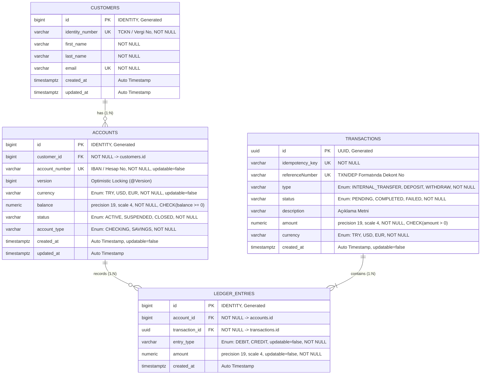
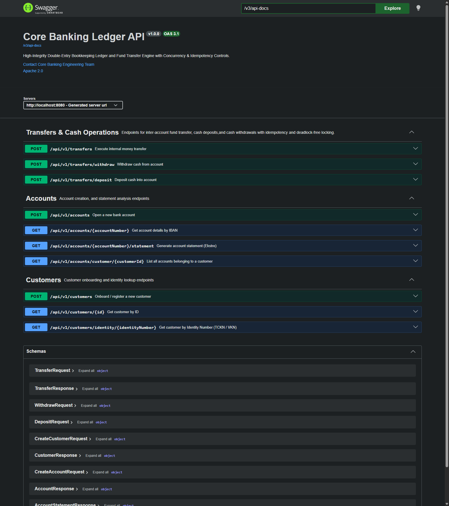

# 🏦 High-Integrity Core Banking Ledger & Fund Transfer Engine

> 🇬🇧 **[Click here for English Documentation (README.md)](./README.md)**

[](https://www.oracle.com/java/)
[](https://spring.io/projects/spring-boot)
[](https://www.postgresql.org/)
[](https://www.docker.com/)
[](https://testcontainers.com/)
[](https://github.com/AKeremT/core-banking-ledger)
[](https://en.wikipedia.org/wiki/Double-entry_bookkeeping)

---

## 📖 Genel Bakış ve Problem Tanımı

Geleneksel web uygulamalarında bakiye yönetimi genellikle `accounts.balance = accounts.balance - 100` gibi doğrudan veritabanı alanı güncelleme mantığı üzerine kurulur. Ancak kurumsal bankacılık ve finansal defter (ledger) sistemlerinde bu yaklaşım kabul edilemez riskler barındırır:

1. **İzlenemezlik (Audit Failure):** Paranın nereden geldiği, nereye gittiği ve hangi atomik işlemle çıktığı geriye dönük matematiksel olarak ispatlanamaz.
2. **Yarış Durumu ve Çift Harcama (Race Conditions & Double Spending):** Birden fazla kanal (ATM, POS, Mobil Bankacılık) aynı anda aynı bakiyeyi okuyup harcama yapmaya çalışırsa bakiye tutarsızlaşır veya negatife düşer.
3. **Karşılıklı Kilitlenme (Deadlock):** A kullanıcısı B'ye para gönderirken (A kilitlenip B'yi bekler), eşzamanlı olarak B kullanıcısı A'ya para gönderirse (B kilitlenip A'yı bekler) sistem kilitlenir ve işlem havuzu tükenir.
4. **Ağ Güvensizliği ve Mükerrer İstekler (Network Flakiness):** İstemcinin isteği zaman aşımına uğrayıp yeniden denendiğinde (retry mekanizması) aynı işlem mükerrer çalışarak hesabın birden çok kez borçlandırılmasına yol açabilir.

**`core-banking-ledger`**, bu kritik finansal problemleri çözmek üzere inşa edilmiş; **Çift Taraflı Muhasebe (Double-Entry Bookkeeping)** prensiplerini işleten, **Ağ tekrarlarına karşı Idempotent** çalışan, **Deadlock-Free Lock Ordering (Sıralı Kilit)** mimarisiyle yüksek eşzamanlılık (concurrency) güvencesi sunan ve **değişmez (immutable/append-only)** defter kayıtları tutan yeni nesil bir çekirdek bankacılık motorudur.

---

## 🏛️ Temel Mimari Prensipler

```
                                  ╔══════════════════════════════╗
                                  ║    İstemci Transfer İsteği   ║
                                  ╚══════════════╦═══════════════╝
                                                 ▼
               ┌──────────────────────────────────────────────────────────────────┐
               │ 🛡️ 1. GÜVENLİK KAPISI: Idempotency Kalkanı                       │
               │    (Aynı Idempotency-Key ile mükerrer işlem anında önlenir)      │
               └─────────────────────────────────┬────────────────────────────────┘
                                                 ▼
               ┌──────────────────────────────────────────────────────────────────┐
               │ 🔍 2. GÜVENLİK KAPISI: Mantıksal Validasyonlar                  │
               │    (Self-Transfer, Para Birimi Eşleşmesi, Hesap Statü Kontrolü) │
               └─────────────────────────────────┬────────────────────────────────┘
                                                 ▼
               ┌──────────────────────────────────────────────────────────────────┐
               │ 🔒 3. GÜVENLİK KAPISI: Deadlock-Free Lock Ordering               │
               │    (min(IBAN_A, IBAN_B) sıralamasıyla PESSIMISTIC_WRITE kilidi)  │
               └─────────────────────────────────┬────────────────────────────────┘
                                                 ▼
               ┌──────────────────────────────────────────────────────────────────┐
               │ 💰 4. GÜVENLİK KAPISI: Bakiye Yeterlilik Kontrolü                │
               │    (Kilitli ve güncel satırdan bakiye doğrulaması)               │
               └─────────────────────────────────┬────────────────────────────────┘
                                                 ▼
               ┌──────────────────────────────────────────────────────────────────┐
               │ ⚖️ 5. ÇİFT TARAFLI DEFTER KAYDI & BAKİYE GÜNCELLEMESİ            │
               │    (1 Atomik TX: 1 DEBIT + 1 CREDIT -> ∑ DEBIT = ∑ CREDIT)       │
               └──────────────────────────────────────────────────────────────────┘
```

### 1. Çift Taraflı Muhasebe (Double-Entry Bookkeeping)
Sistemde bakiye "büyüyle" yaratılmaz veya silinmez. Dışarıdan para yatırıldığında dahi işlem **Sistem Kasa Hesabı (System Transit/Vault Account)** ile müşteri hesabı arasında yürütülür.
* Gönderen / Kasa Hesabı: **`DEBIT` (Borç)**
* Alıcı / Müşteri Hesabı: **`CREDIT` (Alacak)**
* Matematiksel Finansal Denge: $\sum \text{DEBIT} = \sum \text{CREDIT}$

### 2. Deadlock Önleyici Sıralı Kilitleme (Lock Ordering)
İki hesabın karşılıklı transferlerinde kilitlenme riskini (`Deadlock`) sıfırlamak için kilit sırası gönderen/alıcı rolüne göre değil; hesap numaralarının **doğal alfabetik sırasına (`Natural Ordering`)** göre belirlenir:
```java
boolean isSenderFirst = senderAccountNumber.compareTo(receiverAccountNumber) < 0;
String firstLock  = isSenderFirst ? senderAccountNumber : receiverAccountNumber;
String secondLock = isSenderFirst ? receiverAccountNumber : senderAccountNumber;
```

### 3. İstemci Düzeyinde Idempotency Kalkanı
Her finansal işlem için HTTP Header'ında benzersiz bir `Idempotency-Key` (UUID) zorunludur. İşlem başlamadan önce veritabanı kontrol edilir; mükerrer bir istek gelirse kilit alma ve bakiye güncelleme adımları atlanarak ilk başarılı işlemin cevabı anında dönülür.

### 4. Değişmez Defter Kayıtları (Immutable / Append-Only)
`LedgerEntry` tablosuna yazılan hiçbir finansal satır güncellenemez veya silinemez (`updatable = false`). Hatalı işlemler ancak ters yönde yeni bir düzeltme kaydıyla dengelenebilir.

### 5. Finansal Sayısal Bütünlük (Banker's Precision)
Tüm parasal değerler `BigDecimal` ve `NUMERIC(19, 4)` hassasiyetinde tutulur. Veritabanı seviyesinde tanımlanan `@CheckConstraint` kuralları ile negatif bakiye (`balance >= 0`) ve geçersiz işlem tutarları (`amount > 0`) fiziksel olarak engellenir.

---

## 📊 Veritabanı ve Varlık-İlişki Mimarisi (Entity-Relationship)



### Fiziksel Tablo Özeti

| Tablo Adı | Birincil Anahtar | Kritik Kısıtlar (Constraints) | Açıklama |
| :--- | :--- | :--- | :--- |
| `customers` | `BIGINT (IDENTITY)` | `identity_number UNIQUE`, `email UNIQUE` | Müşteri kimlik ve profil verileri |
| `accounts` | `BIGINT (IDENTITY)` | `account_number UNIQUE`, `CHECK (balance >= 0)`, `@Version` | Vadesiz/Vadeli banka hesapları ve bakiye |
| `transactions` | `UUID` | `idempotency_key UNIQUE`, `reference_number UNIQUE` | Finansal operasyon üst bilgisi ve Idempotency takibi |
| `ledger_entries` | `BIGINT (IDENTITY)` | `updatable = false`, `CHECK (amount > 0)` | Çift taraflı borç (`DEBIT`) ve alacak (`CREDIT`) defteri |

---

## 🛠️ Teknoloji Yığını

| Katman / Kütüphane | Versiyon / Teknoloji | Seçim Gerekçesi ve Rolü |
| :--- | :--- | :--- |
| **Dil** | Java 21 LTS | Pattern Matching, Records, Thread-safe concurrent pratikleri |
| **Framework** | Spring Boot 4.1.2 | Kurumsal servis altyapısı, Declarative Transaction Management |
| **Veri Katmanı** | Spring Data JPA / Hibernate | ORM yönetimi, Pessimistic & Optimistic Concurrency Controls |
| **Veritabanı** | PostgreSQL 16 | ACID standartları, Row-Level Locking (`SELECT FOR UPDATE`), Strict Constraints |
| **Konteynerizasyon** | Docker Compose | PostgreSQL veritabanını izole ve kalıcı bir ortamda ayağa kaldırma |
| **Birim Testleri** | JUnit 5 & Mockito | 7 Güvenlik kapısı ve edge-case senaryolarının izole doğrulaması |
| **Entegrasyon Testi** | Testcontainers | Gerçek PostgreSQL üzerinde yüksek eşzamanlılık (concurrency) testleri |
| **Veri Göçü (Migration)** | Flyway (hazırlık) | Veritabanı şema versiyonlama ve DDL script yönetimi |
| **Kod Üretimi** | Lombok | `@Getter`, `@Builder`, `@RequiredArgsConstructor` ile boilerplate minimizasyonu |

---

## 📁 Proje Dizin Yapısı

Proje, katmanlı ve temiz mimari (Clean & Layered Architecture) prensiplerine göre yapılandırılmıştır:

```text
core-banking-ledger/
├── .mvn/                                # Maven wrapper dosyaları
├── src/
│   ├── main/
│   │   ├── java/com/akt/banking_v1/
│   │   │   ├── BankingV1Application.java # Spring Boot giriş noktası
│   │   │   ├── common/
│   │   │   │   └── exception/           # Domain istisna hiyerarşisi & global advice
│   │   │   │       ├── BankingException.java
│   │   │   │       ├── InsufficientBalanceException.java
│   │   │   │       ├── AccountNotFoundException.java
│   │   │   │       ├── AccountInactiveException.java
│   │   │   │       ├── CurrencyMismatchException.java
│   │   │   │       ├── SelfTransferException.java
│   │   │   │       ├── CustomerAlreadyExistsException.java
│   │   │   │       ├── CustomerNotFoundException.java
│   │   │   │       └── GlobalExceptionHandler.java
│   │   │   ├── config/
│   │   │   │   └── DataInitializer.java # Sistem Müşterisi ve Kasa Hesabı başlangıç verisi
│   │   │   ├── controller/              # REST API sunum katmanı
│   │   │   │   ├── TransferController.java # Idempotent transfer & para yatırma uç noktaları
│   │   │   │   ├── AccountController.java  # Hesap açılışı & ekstre uç noktaları
│   │   │   │   └── CustomerController.java # Müşteri kayıt & sorgulama uç noktaları
│   │   │   ├── dto/                     # Jakarta Validation korumalı Record DTO'lar
│   │   │   │   ├── TransferRequest.java / TransferResponse.java
│   │   │   │   ├── CreateAccountRequest.java / AccountResponse.java
│   │   │   │   ├── CreateCustomerRequest.java / CustomerResponse.java
│   │   │   │   ├── DepositRequest.java
│   │   │   │   ├── AccountStatementResponse.java / StatementItemResponse.java
│   │   │   │   └── ErrorResponse.java
│   │   │   ├── enums/                   # Tip güvenli finansal durumlar
│   │   │   │   ├── Currency.java (TRY, USD, EUR)
│   │   │   │   ├── AccountStatus.java (ACTIVE, SUSPENDED, CLOSED)
│   │   │   │   ├── AccountType.java (CHECKING, SAVINGS)
│   │   │   │   ├── TransactionType.java (INTERNAL_TRANSFER, DEPOSIT, WITHDRAW)
│   │   │   │   ├── TransactionStatus.java (PENDING, COMPLETED, FAILED)
│   │   │   │   └── EntryType.java (DEBIT, CREDIT)
│   │   │   ├── mapper/                  # İzole ve test edilebilir DTO mappers
│   │   │   │   ├── TransferMapper.java
│   │   │   │   ├── AccountMapper.java
│   │   │   │   └── CustomerMapper.java
│   │   │   ├── model/                   # JPA Entity modelleri (Double-Entry domain)
│   │   │   │   ├── Customer.java
│   │   │   │   ├── Account.java
│   │   │   │   ├── Transaction.java
│   │   │   │   └── LedgerEntry.java
│   │   │   ├── repository/              # Spring Data JPA & Concurrency Lock Queries
│   │   │   │   ├── CustomerRepository.java
│   │   │   │   ├── AccountRepository.java (findByAccountNumberWithLock)
│   │   │   │   ├── TransactionRepository.java (findByIdempotencyKey)
│   │   │   │   └── LedgerEntryRepository.java (findByAccountIdAndDateRange)
│   │   │   └── service/                 # Finansal iş mantığı motorları
│   │   │       ├── TransferService.java # Transfer, Deposit, Lock Ordering, Idempotency
│   │   │       ├── AccountService.java  # Hesap açılışı, 26 haneli TR IBAN üretimi
│   │   │       ├── CustomerService.java # Müşteri onboarding ve tekillik kontrolleri
│   │   │       └── AccountStatementService.java # Stream API ile hesap ekstresi ve finansal analitik
│   │   └── resources/
│   │       └── application.properties   # Veritabanı ve Hibernate ayarları
│   └── test/
│       └── java/com/akt/banking_v1/
│           ├── BankingV1ApplicationTests.java
│           ├── TestBankingV1Application.java
│           ├── TestcontainersConfiguration.java
│           ├── integration/
│           │   └── TransferConcurrencyIntegrationTest.java # 100-Thread Concurrency & Yarış Durumu Testleri
│           └── service/
│               └── TransferServiceTest.java # 8 Kapsamlı Mockito Birim Test Senaryosu
├── docker-compose.yml                   # PostgreSQL 16 servis tanımı
├── pom.xml                              # Maven bağımlılıkları ve konfigürasyonlar
├── DATABASE_SCHEMA.md                   # Veritabanı ve DDL dokümantasyonu
├── README.md                            # İngilizce dokümantasyon
└── README-tr.md                         # Türkçe ana dokümantasyon (bu dosya)
```

---

## ⚡ Temel Servisler ve İş Mantığı Akışı

### 1. `TransferService` (Transfer & Para Girişi Motoru)
* **`transfer(TransferRequest, idempotencyKey)`:**
  1. **Idempotency Denetimi:** `transactionRepository.findByIdempotencyKey(key)` ile sorgulanır. Kayıt varsa işlem tekrarlanmaz, önbellekteki işlem `TransferResponse` olarak dönülür.
  2. **Self-Transfer Koruması:** Gönderen ve alıcı hesap aynı olamaz.
  3. **Deadlock-Free Lock Ordering:** Hesap numaraları karşılaştırılarak (`compareTo`) küçük olan hesap önce, büyük olan sonra `PESSIMISTIC_WRITE` (`SELECT ... FOR UPDATE`) kilidiyle okunur.
  4. **Durum & Döviz Kontrolleri:** Her iki hesabın `ACTIVE` olduğu ve aynı para birimine sahip olduğu doğrulanır.
  5. **Bakiye Kontrolü:** Gönderen hesap bakiyesinin işlem tutarını karşıladığı teftiş edilir.
  6. **Bakiye Güncellemesi:** Gönderen bakiyesinden düşülür, alıcı bakiyesine eklenir.
  7. **Çift Taraflı Defter Satırları:** 1 adet `Transaction` başlığı altında 1 adet `DEBIT` ve 1 adet `CREDIT` satırı atomik olarak kaydedilir.
  8. **Dekont No Üretimi:** `TXN-YYYYMMDD-UUID8` formatında tekil referans numarası atanır.
* **`deposit(DepositRequest, idempotencyKey)`:**
  * Dışarıdan hesaba nakit yatırılması durumunda paranın kaynağı olarak **`DataInitializer.SYSTEM_TRY_ACCOUNT` (Kasa Hesabı)** kullanılır. Kasa borçlandırılır (`DEBIT`), müşteri hesabı alacaklandırılır (`CREDIT`).
  * Dekont referans numarası `DEP-YYYYMMDD-UUID8` formatında üretilir.

### 2. `AccountService` (Hesap Açılışı ve IBAN Motoru)
* **Otomatik IBAN Üretimi:** `ThreadLocalRandom` ile Türkiye bankacılık standartlarına uygun `TR` önekli 24 haneli rakam bloğu (`TR` + 24 hane = 26 karakter) üretilir.
* **Collision Guard:** Üretilen IBAN'ın benzersiz olduğu `existsByAccountNumber` ile doğrulanır.
* **Varsayılan Güvenlik:** Yeni açılan hesaplar daima `ACTIVE` statüde ve `0.0000` bakiye ile başlatılır.

### 3. `CustomerService` (Müşteri Onboarding)
* TCKN/Vergi No ve e-posta adreslerinin tekilliği uygulama katmanında savunmacı kontrollerle (`existsByIdentityNumber`, `existsByEmail`) teftiş edilir.

### 4. `AccountStatementService` (Finansal Ekstre ve Analiz Motoru)
* **Yüksek Performanslı Stream API:** Defter geçmişi bellekte `filter`, `reduce` ve `collect(groupingBy)` kullanılarak sıfır bellek sızıntısıyla işlenir.
* **Esnek Tarih Penceresi:** Belirtilen tarih aralığında (`startDate` - `endDate`) ekstre dökümü oluşturulur; tarih verilmediğinde varsayılan son 30 günü analiz eder.
* **Nakit Akış Analitiği:** Toplam borç (debit), toplam alacak (credit) ve net nakit akışı hesaplanır:
  $$\text{Net Akış} = \sum \text{CREDIT} - \sum \text{DEBIT}$$
* **İşlem Türüne Göre Kırılım:** Hareketler `TransactionType` (`INTERNAL_TRANSFER`, `DEPOSIT`, `WITHDRAW`) bazında gruplanarak kullanıcıya raporlanır.

---

## 🌐 REST API Uç Noktaları (Endpoints)

Sunum katmanı; Jakarta Bean Validation teftişli, client idempotency korumalı ve RFC-7807 standartlarında hata yanıtı üreten RESTful servislere sahiptir:

| Metot | Uç Nokta (Endpoint) | Zorunlu Header | Açıklama | HTTP Kodu |
| :--- | :--- | :--- | :--- | :--- |
| `POST` | `/api/v1/transfers` | `Idempotency-Key` | İki hesap arasında çift taraflı havale/virman | `200 OK` |
| `POST` | `/api/v1/transfers/deposit` | `Idempotency-Key` | Sistem Kasasından hesaba nakit yatırma | `200 OK` |
| `POST` | `/api/v1/transfers/withdraw` | `Idempotency-Key` | Hesaptan nakit çekme (Vault alacak, Müşteri borç) | `200 OK` |
| `POST` | `/api/v1/accounts` | - | Otomatik TR IBAN'lı yeni banka hesabı açma | `201 CREATED` |
| `GET` | `/api/v1/accounts/{accountNumber}` | - | Hesap özeti ve anlık bakiye sorgulama | `200 OK` |
| `GET` | `/api/v1/accounts/customer/{customerId}` | - | Müşteriye ait tüm hesapları listeleme | `200 OK` |
| `GET` | `/api/v1/accounts/{accountNumber}/statement` | - | Tarih aralıklı hesap ekstresi ve net akış | `200 OK` |
| `POST` | `/api/v1/customers` | - | Yeni bireysel müşteri kaydı oluşturma | `201 CREATED` |
| `GET` | `/api/v1/customers/{id}` | - | Müşteri profil bilgilerini ID ile getirme | `200 OK` |
| `GET` | `/api/v1/customers/identity/{identityNumber}` | - | TCKN/Vergi No ile müşteri sorgulama | `200 OK` |

---

### 📑 Canlı Swagger UI & OpenAPI 3 Dokümantasyonu

Uygulama ayağa kalktığında `http://localhost:8080/swagger-ui.html` adresinden erişilebilen tam interaktif API arayüzü:



---

### 📊 Canlı Hesap Ekstresi (Account Statement) JSON Yanıtı

`GET /api/v1/accounts/{accountNumber}/statement` sorgusunun Java Stream API tarafından hesaplanan gerçek çıktısı:

```json
{
  "accountNumber": "TR244134513831384376055830",
  "currency": "TRY",
  "currentBalance": 750.0000,
  "startDate": "2026-10-04T16:06:50Z",
  "endDate": "2026-11-03T16:06:50Z",
  "totalCredit": 1000.0000,
  "totalDebit": 250.0000,
  "netChange": 750.0000,
  "summaryByType": {
    "DEPOSIT": 1000.0000,
    "WITHDRAW": 250.0000
  },
  "items": [
    {
      "referenceNumber": "WDR-20261103-6C1D102E",
      "entryType": "DEBIT",
      "transactionType": "WITHDRAW",
      "amount": 250.0000,
      "description": "ATM Nakit Çekme",
      "createdAt": "2026-11-03T16:01:16Z"
    },
    {
      "referenceNumber": "DEP-20261103-C5BF4F0A",
      "entryType": "CREDIT",
      "transactionType": "DEPOSIT",
      "amount": 1000.0000,
      "description": "Maaş Yatırma",
      "createdAt": "2026-11-03T16:00:04Z"
    }
  ]
}
```

#### Merkezi Hata Yakalama (`GlobalExceptionHandler`)
Tüm iş kuralı ihlalleri, bulunamayan kayıtlar ve validasyon hataları RFC-7807 uyumlu `ErrorResponse` yapısıyla döner:
```json
{
  "timestamp": "2026-11-03T09:40:00Z",
  "status": 400,
  "error": "Bad Request",
  "message": "Sender account balance is insufficient for this transfer",
  "path": "/api/v1/transfers"
}
```

---

## 🧪 Test Stratejisi ve Doğrulama Disiplini

Sistem kalitesi ve finansal doğruluğu, **Mockito Birim Testleri** ve **Testcontainers** altyapısıyla garanti altına alınmıştır.

### `TransferServiceTest` Kapsamı (9/9 Başarılı)

```
[INFO] Running com.akt.banking_v1.service.TransferServiceTest
[INFO] Tests run: 9, Failures: 0, Errors: 0, Skipped: 0, Time elapsed: 1.092 s
[INFO] BUILD SUCCESS
```

| # | Test Metodu | Test Edilen Senaryo | Doğrulama & Teftiş Mekanizması |
| :---: | :--- | :--- | :--- |
| **1** | `transfer_whenValidRequest_shouldCompleteSuccessfully` | **Happy Path:** Standart iki hesap arası başarılı transfer | Doğal kilit sırası, kuruş hassasiyetli bakiye değişimi, `save` ve `toResponse` teftişi |
| **2** | `transfer_whenIdempotencyKeyIsPresent_shouldReturnExistingTransfer` | **Idempotency Kalkanı:** Mükerrer istek yakalama | Sıfır DB kilitleme (`never().findByAccountNumberWithLock`), anında eski yanıt dönüşü |
| **3** | `transfer_whenSenderAndReceiverSame_shouldThrowSelfTransferException` | **Self-Transfer Koruması:** Kendi kendine transfer engeli | Bellek içi hızlı fail, sıfır DB kilit ve sıfır transaction kaydı |
| **4** | `transfer_whenInsufficientBalance_shouldThrowInsufficientBalanceException` | **Yetersiz Bakiye Kontrolü:** Kilit sonrası bakiye koruması | `never().save(Transaction)` ile veri tabanına yarım kayıt yazılmadığının kanıtlanması |
| **5** | `transfer_whenAccountNotFound_shouldThrowAccountNotFoundException` | **Hesap Bulunamadı:** Erken çıkış (Fail-Fast) | `UnnecessaryStubbingException` uyumlu temiz mock yönetimi |
| **6** | `transfer_whenAccountIsInactive_shouldThrowAccountInactiveException` | **İnaktif Hesap Güvenliği:** Askıya alınmış (`SUSPENDED`) veya kapalı hesap | Transferin bloke edilmesi ve istisna fırlatılması |
| **7** | `transfer_whenCurrencyMismatch_shouldThrowCurrencyMismatchException` | **Döviz Uyuşmazlığı:** TRY ile USD/EUR arası transfer engeli | Farklı para birimlerinin kilit sonrası reddedilmesi |
| **8** | `deposit_whenValidRequest_shouldDepositSuccessfully` | **Kasa Para Girişi (Deposit):** Sistem kasasından alacaklandırma | Kasa hesabına `DEBIT`, müşteriye `CREDIT`, `DEP-` referans numarası teftişi |
| **9** | `withdraw_whenValidRequest_shouldWithdrawSuccessfully` | **Para Çekme (Withdraw):** Müşteriden nakit çekim | Müşteri hesabına `DEBIT`, Kasa hesabına `CREDIT`, bakiye kontrolü ve `WDR-` dekont teftişi |

### `TransferConcurrencyIntegrationTest` Test Paketi (Testcontainers & PostgreSQL 16)

Gerçek PostgreSQL 16 veritabanı konteyneri üzerinde **Testcontainers**, `ExecutorService` ve `CountDownLatch` ile eşzamanlı yarış durumları ve kilitleme test edilmiştir:

| # | Eşzamanlılık Test Senaryosu | Concurrency Yükü | Doğrulanan Finansal Değişmez (Invariant) | Sonuç |
| :---: | :--- | :--- | :--- | :--- |
| **1** | `testDeadlockFreeCrossTransfersConcurrently` | **100 Eşzamanlı Thread**<br/>(50 thread: Hesap A $\rightarrow$ B)<br/>(50 thread: Hesap B $\rightarrow$ A) | **Sıfır Deadlock ve Bakiye Korunumu:**<br/>Alfabetik IBAN kilitleme sırası döngüsel deadlock'u engeller. 100 transferin tamamı hatasız tamamlanır. Toplam para kuruşu kuruşuna korunur ($\sum \text{Bakiyeler} = 20.000,0000 \text{ TRY}$). | `BAŞARILI` (0 Deadlock) |
| **2** | `testDoubleSpendingPreventionConcurrently` | **50 Eşzamanlı Thread**<br/>(Tam 100 TRY bakiyesi olan hesaptan aynı anda 100 TRY çekmeye çalışan 50 thread) | **Yarış Durumu & Çift Harcama Engeli:**<br/>Satır düzeyinde `SELECT ... FOR UPDATE` kilidi sayesinde sadece 1 istek geçer. Kalan 49 istek `InsufficientBalanceException` ile anında reddedilir. Son bakiye kesin olarak `0,0000 TRY` kalır. | `BAŞARILI` (0 Açık Bakiye) |

---

## 📚 Mimari ve Şema Dokümantasyonu

Repozituvarda, projenin domain varlıklarını, çift taraflı muhasebe akışını ve PostgreSQL DDL şemasını detaylandıran teknik dokümantasyon bulunmaktadır:

* 📄 **[`DATABASE_SCHEMA.md`](./DATABASE_SCHEMA.md):** Detaylı veritabanı şeması, Mermaid ER diyagramları, çift taraflı muhasebe akışları, DDL kısıtları ve eşzamanlılık kilit mimarisi.

---

## 🚀 Kurulum ve Çalıştırma Kılavuzu

### Ön Gereksinimler
* **Java:** JDK 21 LTS veya üzeri
* **Maven:** 3.9+ (veya proje kök dizinindeki `./mvnw`)
* **Docker & Docker Compose:** PostgreSQL veritabanı servisi için

### 1. Repoyu Klonlayın
```bash
git clone https://github.com/AKeremT/core-banking-ledger.git
cd core-banking-ledger
```

### 2. Veritabanını Docker ile Ayağa Kaldırın
```bash
docker compose up -d
```
> PostgreSQL servisi `localhost:5432` üzerinde, `core_banking_ledger` veritabanı adı, `akt` kullanıcı adı ve `akt` parolasıyla hazır hale gelecektir.

### 3. Testleri Koşturun
```bash
# Windows
.\mvnw.cmd clean test

# Linux / macOS
./mvnw clean test
```

### 4. Uygulamayı Başlatın
```bash
# Windows
.\mvnw.cmd spring-boot:run

# Linux / macOS
./mvnw spring-boot:run
```
> Uygulama ilk kez ayağa kalktığında `DataInitializer` devreye girerek **Sistem Müşterisi**, 1 Milyar TL bakiyeli **Sistem Kasa Hesabı** (`TR000000000000000000000001`) ve varsayılan test kullanıcılarını (`system_admin`, `teller_user`, `customer_user`) otomatik olarak oluşturacaktır.

---

## 🗺️ Yol Haritası ve Gelecek Adımlar

- [x] Case study teknik şartnamesi ve domain analizi (`Double-Entry Bookkeeping`).
- [x] PostgreSQL 16 Docker Compose ortamının kurulması.
- [x] JPA Entity'leri, enum'lar, `@Version` ve `@CheckConstraint` kuralları.
- [x] Concurrency odaklı Repository katmanı (`@Lock(LockModeType.PESSIMISTIC_WRITE)`).
- [x] Jakarta Bean Validation destekli Record DTO'lar ve istisna hiyerarşisi.
- [x] Transfer motoru (`TransferService.transfer` ve `TransferService.deposit`).
- [x] Otomatik TR IBAN motoru ile Müşteri ve Hesap servisleri (`AccountService`, `CustomerService`).
- [x] Mockito ile 9 senaryolu kapsamlı birim test zırhı (`TransferServiceTest` - 9/9 Başarılı).
- [x] **REST Controller & Global Exception Handling:** HTTP katmanının (`@RestController`, `@ControllerAdvice`) ve `Idempotency-Key` kalkanının tamamlanması.
- [x] **Testcontainers Concurrency Stres Testi:** 100 eşzamanlı thread ile gerçek PostgreSQL üzerinde Race Condition ve Deadlock testi.
- [x] **Finansal Ekstre ve Analiz Motoru:** Java Stream API (`groupingBy`, `reduce`) ile hesap hareketlerinin raporlanması.
- [x] **Para Çekme (Withdrawal) Operasyonu:** Müşteri hesabı borçlandırılır, kasa alacaklandırılır (`TransferService.withdraw`).
- [x] **Flyway Database Migration:** Şemanın fiziksel SQL scriptleri ile versiyonlanması (`V1__init_schema.sql`, `V2__create_users_table.sql`, `ddl-auto=validate`).
- [x] **OpenAPI 3 / Swagger Dokümantasyonu:** `springdoc-openapi` 3.2.0 ile interaktif canlı test arayüzü (`/swagger-ui.html`).
- [x] **Spring Security & JWT (RBAC):** Pure stateless JWT filtre mimarisi (`OncePerRequestFilter`), metot seviyesinde güvenlik (`@EnableMethodSecurity`, `@PreAuthorize`), rol tabanlı erişim denetimi (`ROLE_CUSTOMER`, `ROLE_TELLER`, `ROLE_SYSTEM`), Flyway V2 kullanıcı şeması ve kimlik doğrulama (`/api/v1/auth/login`).
- [ ] **Gözlemlenebilirlik ve Metrikler (Observability):** Spring Boot Actuator, Prometheus metrikleri ve Kubernetes health probe'ları.
- [ ] **Güvenlik Entegrasyon Testleri:** `@WithMockUser` ile 401 Unauthorized, 403 Forbidden ve 200/201 yetki sınırlarının otomatik MockMvc testleri.

---

## 👤 Geliştirici

* **Geliştirici:** Kerem ([@AKeremT](https://github.com/AKeremT))
* **Çalışma Modeli:** AI-Assisted Socratic Mentorship & Dual-Track Engineering Discipline
