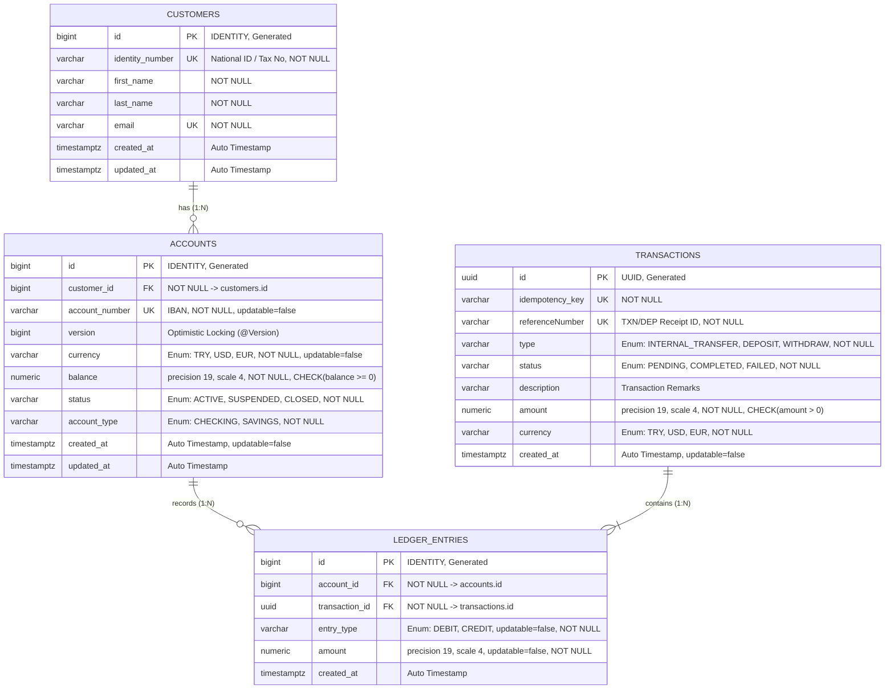
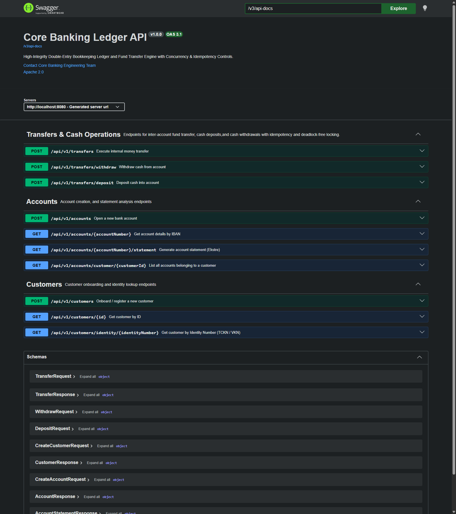
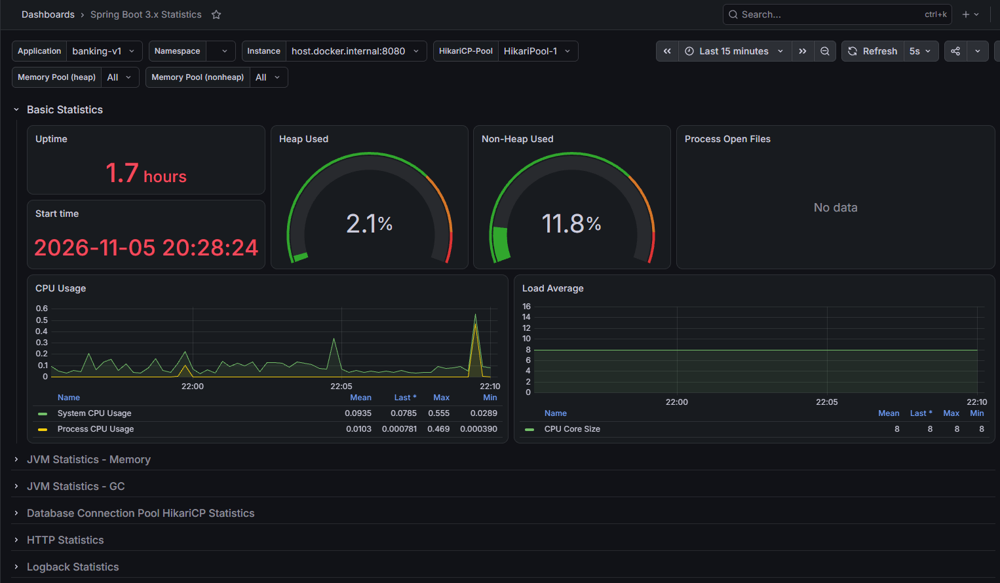

# 🏦 High-Integrity Core Banking Ledger & Fund Transfer Engine

> 🇹🇷 **[Türkçe Dokümantasyon için buraya tıklayın (README-tr.md)](./README-tr.md)**

[](https://www.oracle.com/java/)
[](https://spring.io/projects/spring-boot)
[](https://www.postgresql.org/)
[](https://www.docker.com/)
[](https://testcontainers.com/)
[](https://github.com/AKeremT/core-banking-ledger)
[](https://en.wikipedia.org/wiki/Double-entry_bookkeeping)

---

## 📖 Executive Summary & Problem Statement

In conventional CRUD applications, account balance management is frequently handled via naive in-place database updates such as `accounts.balance = accounts.balance - 100`. In enterprise banking, fintech, and distributed ledger systems, this approach is catastrophic due to four core architectural pitfalls:

1. **Audit Trail Failure:** Naive balance overwrites fail to record where funds originated, where they were routed, and under which atomic action. Proving mathematical balance consistency over time is impossible.
2. **Race Conditions & Double Spending:** When multiple channels (ATMs, POS terminals, mobile apps) execute concurrent withdrawals against the same account, uncommitted balance snapshots lead to dirty reads and unauthorized overdrafts.
3. **Deadlocks in Bilateral Transfers:** When User A sends money to User B (locking A and waiting for B) while User B concurrently sends money to User A (locking B and waiting for A), a database **Deadlock** ensues, exhausting connection pools.
4. **Network Flakiness & Duplicate Executions:** Transient network timeouts prompt client retries. Without an idempotency barrier, retried requests re-execute the transfer, charging the client multiple times.

**`core-banking-ledger`** is an enterprise-grade core banking engine designed to eliminate these vulnerabilities. It enforces **Double-Entry Bookkeeping** ($\sum \text{DEBIT} = \sum \text{CREDIT}$), provides **Client-Side Idempotency**, implements **Deadlock-Free Lock Ordering (Lexicographical Natural Sorting)**, maintains **Append-Only Immutable Ledger Entries**, and preserves **Banker's Precision** through strict database-level constraints.

---

## 🏛️ Core Architectural Pillars

```
                                  ╔══════════════════════════════╗
                                  ║    Client Transfer Request   ║
                                  ╚══════════════╦═══════════════╝
                                                 ▼
               ┌──────────────────────────────────────────────────────────────────┐
               │ 🛡️ GATE 1: Idempotency Verification Shield                       │
               │    (Detect duplicate requests; return cached receipt instantly)  │
               └─────────────────────────────────┬────────────────────────────────┘
                                                 ▼
               ┌──────────────────────────────────────────────────────────────────┐
               │ 🔍 GATE 2: Domain Invariant Validations                          │
               │    (Self-Transfer check, Currency parity, Account active status) │
               └─────────────────────────────────┬────────────────────────────────┘
                                                 ▼
               ┌──────────────────────────────────────────────────────────────────┐
               │ 🔒 GATE 3: Deadlock-Free Deterministic Lock Ordering             │
               │    (Acquire PESSIMISTIC_WRITE locks via min(IBAN_A, IBAN_B))    │
               └─────────────────────────────────┬────────────────────────────────┘
                                                 ▼
               ┌──────────────────────────────────────────────────────────────────┐
               │ 💰 GATE 4: Balance Solvency Verification                         │
               │    (Ensure sender balance >= transfer amount on locked row)      │
               └─────────────────────────────────┬────────────────────────────────┘
                                                 ▼
               ┌──────────────────────────────────────────────────────────────────┐
               │ ⚖️ GATE 5: Atomic Double-Entry Ledger Posting & Mutation         │
               │    (1 Transaction: 1 DEBIT + 1 CREDIT -> ∑ DEBIT = ∑ CREDIT)     │
               └──────────────────────────────────────────────────────────────────┘
```

### 1. Double-Entry Bookkeeping
Money is never created or destroyed out of thin air. Even external cash deposits are routed through an internal **System Transit / Bank Vault Account** (`TR000000000000000000000001`):
* Originating / Vault Account: **`DEBIT`**
* Beneficiary / Customer Account: **`CREDIT`**
* Strict Mathematical Invariant: $\sum \text{DEBIT} = \sum \text{CREDIT}$

### 2. Deadlock-Free Lock Ordering (Lexicographical Sorting)
To guarantee that concurrent cross-transfers between two accounts never trigger a database deadlock, account locks are acquired strictly in **lexicographical natural order** rather than sender/receiver order:
```java
boolean isSenderFirst = senderAccountNumber.compareTo(receiverAccountNumber) < 0;
String firstLock  = isSenderFirst ? senderAccountNumber : receiverAccountNumber;
String secondLock = isSenderFirst ? receiverAccountNumber : senderAccountNumber;

// Locks are acquired in identical order across all threads
Account firstAccount  = accountRepository.findByAccountNumberWithLock(firstLock)...;
Account secondAccount = accountRepository.findByAccountNumberWithLock(secondLock)...;
```

### 3. Client-Side Idempotency Shield
Clients must supply a unique `Idempotency-Key` (UUID) with each financial request. Before any lock acquisition or balance check, the database is queried. If the transaction has already completed, the transfer engine short-circuits immediately, returning the existing receipt without mutating account balances or acquiring database locks.

### 4. Append-Only Immutable Ledger Entries
All historical movements written to `ledger_entries` are permanent and immutable (`updatable = false`). Transaction corrections or chargebacks are performed strictly via new compensatory debit/credit entries, preserving complete forensic auditability.

### 5. High-Precision Numerical Integrity (Banker's Precision)
All monetary fields utilize Java `BigDecimal` and PostgreSQL `NUMERIC(19, 4)` to avoid IEEE 754 floating-point inaccuracies. Database `@CheckConstraint` rules guarantee that account balances can never drop below zero (`balance >= 0`) and transfer amounts are strictly positive (`amount > 0`).

---

## 📊 Database & Entity-Relationship Architecture



### Physical Schema Data Dictionary

| Table Name | Primary Key | Key Constraints & Invariants | Description |
| :--- | :--- | :--- | :--- |
| `customers` | `BIGINT (IDENTITY)` | `identity_number UNIQUE`, `email UNIQUE` | Customer identification and profile records |
| `accounts` | `BIGINT (IDENTITY)` | `account_number UNIQUE`, `CHECK (balance >= 0)`, `@Version` | Deposit accounts, current balance, and optimistic lock version |
| `transactions` | `UUID` | `idempotency_key UNIQUE`, `reference_number UNIQUE` | Root financial transaction metadata and idempotency tracking |
| `ledger_entries` | `BIGINT (IDENTITY)` | `updatable = false`, `CHECK (amount > 0)` | Immutable double-entry line items (`DEBIT` & `CREDIT`) |

---

## 🛠️ Technology Stack

| Layer / Component | Version / Technology | Architectural Rationale & Role |
| :--- | :--- | :--- |
| **Language** | Java 21 LTS | Pattern Matching, Sealed Records, Enhanced Concurrency semantics |
| **Framework** | Spring Boot 4.1.2 | Enterprise web platform, declarative `@Transactional` management |
| **Persistence** | Spring Data JPA / Hibernate | ORM mapping, Pessimistic (`PESSIMISTIC_WRITE`) & Optimistic Locking |
| **Database** | PostgreSQL 16 | ACID-compliant RDBMS, row-level locks (`SELECT FOR UPDATE`), DDL constraints |
| **Containerization**| Docker Compose | Reproducible, isolated, and persisted local PostgreSQL instance |
| **Unit Testing** | JUnit 5 & Mockito | Fast, isolated test suite verifying all 7 security gates and edge cases |
| **Integration Test**| Testcontainers | Concurrency verification on real containerized PostgreSQL instances |
| **Schema Migration**| Flyway (ready) | Database schema versioning and DDL lifecycle control |
| **Boilerplate Tool**| Project Lombok | Data classes, builders, slf4j logging annotations |

---

## 📁 Project Directory Structure

The project follows Clean & Layered Architecture standards:

```text
core-banking-ledger/
├── .mvn/                                # Maven wrapper configuration
├── docker/
│   ├── prometheus/
│   │   └── prometheus.yml          # Prometheus scrape targets & 5s interval config
│   └── grafana/
│       └── provisioning/
│           └── datasources/
│               └── datasource.yml  # Zero-touch auto-provisioned Prometheus datasource
├── docs/
│   └── images/
│       ├── swagger-ui.png          # Interactive Swagger UI screenshot
│       └── grafana_log.png         # Live Grafana dashboard under 1,000 requests
├── src/
│   ├── main/
│   │   ├── java/com/akt/banking_v1/
│   │   │   ├── BankingV1Application.java # Spring Boot entry point
│   │   │   ├── common/
│   │   │   │   └── exception/           # Domain exception hierarchy & global advice
│   │   │   │       ├── BankingException.java
│   │   │   │       ├── InsufficientBalanceException.java
│   │   │   │       ├── AccountNotFoundException.java
│   │   │   │       ├── AccountInactiveException.java
│   │   │   │       ├── CurrencyMismatchException.java
│   │   │   │       ├── SelfTransferException.java
│   │   │   │       ├── CustomerAlreadyExistsException.java
│   │   │   │       ├── CustomerNotFoundException.java
│   │   │   │       └── GlobalExceptionHandler.java
│   │   │   ├── config/
│   │   │   │   ├── DataInitializer.java    # Seeds System Vault Account & Default RBAC Users
│   │   │   │   ├── OpenApiConfig.java      # OpenAPI 3 / Swagger documentation setup
│   │   │   │   ├── SecurityConfig.java     # Security filter chain, CORS, Session & First-Match-Wins rules
│   │   │   │   └── SecurityProperties.java # Type-safe @ConfigurationProperties for JWT
│   │   │   ├── controller/                 # REST API presentation layer
│   │   │   │   ├── AuthController.java     # JWT authentication & login endpoints
│   │   │   │   ├── TransferController.java # Idempotent transfer, deposit & withdrawal endpoints
│   │   │   │   ├── AccountController.java  # Account onboarding & statement endpoints
│   │   │   │   └── CustomerController.java # Customer onboarding & query endpoints
│   │   │   ├── dto/                        # Jakarta Validation-guarded Record DTOs
│   │   │   │   ├── LoginRequest.java / AuthResponse.java
│   │   │   │   ├── TransferRequest.java / TransferResponse.java
│   │   │   │   ├── CreateAccountRequest.java / AccountResponse.java
│   │   │   │   ├── CreateCustomerRequest.java / CustomerResponse.java
│   │   │   │   ├── DepositRequest.java / WithdrawRequest.java
│   │   │   │   ├── AccountStatementResponse.java / StatementItemResponse.java
│   │   │   │   └── ErrorResponse.java
│   │   │   ├── enums/                      # Type-safe financial domain states & roles
│   │   │   │   ├── Role.java (CUSTOMER, TELLER, SYSTEM)
│   │   │   │   ├── Currency.java (TRY, USD, EUR)
│   │   │   │   ├── AccountStatus.java (ACTIVE, SUSPENDED, CLOSED)
│   │   │   │   ├── AccountType.java (CHECKING, SAVINGS)
│   │   │   │   ├── TransactionType.java (INTERNAL_TRANSFER, DEPOSIT, WITHDRAW)
│   │   │   │   ├── TransactionStatus.java (PENDING, COMPLETED, FAILED)
│   │   │   │   └── EntryType.java (DEBIT, CREDIT)
│   │   │   ├── mapper/                     # Decoupled entity-to-DTO converters
│   │   │   │   ├── TransferMapper.java
│   │   │   │   ├── AccountMapper.java
│   │   │   │   └── CustomerMapper.java
│   │   │   ├── model/                      # JPA Entities (Double-entry domain & Security)
│   │   │   │   ├── Customer.java
│   │   │   │   ├── Account.java
│   │   │   │   ├── Transaction.java
│   │   │   │   ├── LedgerEntry.java
│   │   │   │   └── User.java               # Implements UserDetails for Spring Security
│   │   │   ├── repository/                 # Spring Data JPA repositories with lock queries
│   │   │   │   ├── CustomerRepository.java
│   │   │   │   ├── AccountRepository.java  # findByAccountNumberWithLock (Pessimistic Write)
│   │   │   │   ├── TransactionRepository.java # findByIdempotencyKey
│   │   │   │   ├── LedgerEntryRepository.java # findByAccountIdAndDateRange
│   │   │   │   └── UserRepository.java     # findByUsername, existsByUsername
│   │   │   ├── security/                   # Pure Stateless Security Filter
│   │   │   │   └── JwtAuthenticationFilter.java # OncePerRequestFilter for Bearer JWT
│   │   │   └── service/                    # Core financial & authentication engines
│   │   │       ├── TransferService.java    # Transfer, Deposit, Withdraw, Lock Ordering, Idempotency
│   │   │       ├── AccountService.java     # Account onboarding, 26-char TR IBAN generator
│   │   │       ├── CustomerService.java    # Customer onboarding & uniqueness verification
│   │   │       ├── AccountStatementService.java # Stream API statements & financial analytics
│   │   │       ├── AuthService.java        # Authentication orchestration & token issue
│   │   │       ├── CustomUserDetailsService.java # UserDetails loader for DaoAuthenticationProvider
│   │   │       └── JwtService.java         # JJWT 0.12 cryptographic signature & claims parser
│   │   └── resources/
│   │       ├── application.properties      # Connection pool, Hibernate, JWT, and Actuator config
│   │       └── db/migration/               # Flyway automated physical DDL migrations
│   │           ├── V1__init_schema.sql     # Baseline financial schema & check constraints
│   │           └── V2__create_users_table.sql # Users table & role indexing
│   └── test/
│       └── java/com/akt/banking_v1/
│           ├── BankingV1ApplicationTests.java
│           ├── TestBankingV1Application.java
│           ├── TestcontainersConfiguration.java
│           ├── integration/
│           │   └── TransferConcurrencyIntegrationTest.java # 100-Thread Concurrency & Race Condition Tests
│           └── service/
│               └── TransferServiceTest.java # 9 Exhaustive Mockito Unit Test Scenarios
├── docker-compose.yml                      # PostgreSQL 16, Prometheus & Grafana stack
├── pom.xml                                 # Maven build descriptors and plugins
├── DATABASE_SCHEMA.md                      # Complete database DDL & architecture specs
├── README.md                               # Primary English documentation (this file)
└── README-tr.md                            # Turkish documentation
```

---

## ⚡ Core Business Workflows

### 1. `TransferService` (The Core Transfer Engine)
* **`transfer(TransferRequest, idempotencyKey)`:**
  1. **Idempotency Check:** Checks `transactionRepository.findByIdempotencyKey(key)`. If found, immediately returns the cached transaction response without acquiring row locks.
  2. **Self-Transfer Prevention:** Validates that `senderAccountNumber != receiverAccountNumber`.
  3. **Deadlock-Free Lock Ordering:** Evaluates lexicographical precedence (`sender.compareTo(receiver)`). Locks the smaller IBAN first using `@Lock(LockModeType.PESSIMISTIC_WRITE)` (`SELECT ... FOR UPDATE`), then the second IBAN.
  4. **Account & Currency Validation:** Asserts both accounts are `ACTIVE` and operate in identical currencies.
  5. **Balance Check:** Ensures `sender.balance >= request.amount`.
  6. **Balance Mutation:** Atomically debits sender balance and credits receiver balance.
  7. **Double-Entry Ledger Creation:** Emits a `Transaction` entity enclosing one `DEBIT` `LedgerEntry` and one `CREDIT` `LedgerEntry`.
  8. **Receipt Generation:** Issues a standard financial reference ID: `TXN-YYYYMMDD-UUID8`.
* **`deposit(DepositRequest, idempotencyKey)`:**
  * Uses the internal **`DataInitializer.SYSTEM_TRY_ACCOUNT` (Central Bank Vault Account)** as the funding source.
  * Debits the vault account (`DEBIT`) and credits the customer account (`CREDIT`), maintaining $\sum \text{DEBIT} = \sum \text{CREDIT}$. Generates a `DEP-YYYYMMDD-UUID8` reference ID.
* **`withdraw(WithdrawRequest, idempotencyKey)`:**
  * Debits the customer account (`DEBIT`) and credits the Central Vault account (`CREDIT`), maintaining double-entry balance.
  * Enforces deterministic lock ordering (`compareTo`) and strict solvency checks (`InsufficientBalanceException`). Generates a `WDR-YYYYMMDD-UUID8` reference ID.

### 2. `AccountService` (Onboarding & IBAN Engine)
* **Turkish IBAN Generation:** Uses `ThreadLocalRandom` to generate authentic 26-character Turkish IBANs (`TR` + 24 numeric digits).
* **Collision Guard:** Verifies IBAN uniqueness via `existsByAccountNumber` before persisting.
* **Safe Initialization:** Enforces initial balance of `0.0000` and `ACTIVE` status by default.

### 3. `CustomerService` (Customer Onboarding)
* Guarantees identity number (TCKN/Tax ID) and email uniqueness through defensive pre-persistence checks (`existsByIdentityNumber`, `existsByEmail`).

### 4. `AccountStatementService` (Financial Statement & Analytics Engine)
* **High-Performance Stream Processing:** Employs Java Stream API (`filter`, `reduce`, `collect(groupingBy)`) for zero-allocation, thread-safe in-memory aggregation of ledger history.
* **Flexible Date Windows:** Generates financial statements over user-defined intervals (`startDate` to `endDate`), defaulting to the last 30 calendar days when omitted.
* **Cash Flow Analytics:** Calculates total debits, total credits, and net financial flow:
  $$\text{Net Cash Flow} = \sum \text{CREDIT} - \sum \text{DEBIT}$$
* **Breakdown by Transaction Type:** Dynamically categorizes line items by `TransactionType` (`INTERNAL_TRANSFER`, `DEPOSIT`, `WITHDRAW`) for clear debit/credit attribution.

### 5. `AuthService` & Security Architecture (JWT & RBAC)
* **Pure Stateless Authentication:** Pure stateless JWT issuance via JJWT 0.12 fluent API with custom role claims and cryptographic signature verification.
* **Declarative Method Security (`@PreAuthorize`):** Granular role-based access control protecting controller operations:
  * `ROLE_CUSTOMER`: Accesses customer statements and personal balance inquiries.
  * `ROLE_TELLER`: Authorized for branch deposit, withdrawal, account onboarding, and cross-customer transfers.
  * `ROLE_SYSTEM`: Technical service authority for vault initialization and low-level internal telemetry (`/actuator/**`).

---

## 🌐 REST API Specification

The presentation layer exposes RESTful endpoints with strict Jakarta Bean Validation, client idempotency enforcement, and RFC-7807 structured error responses:

| Method | Endpoint | Required Headers / Body | Description | Status Code |
| :--- | :--- | :--- | :--- | :--- |
| `POST` | `/api/v1/auth/login` | `LoginRequest` (username, password) | Authenticates credentials & issues Bearer JWT access token | `200 OK` |
| `POST` | `/api/v1/transfers` | `Idempotency-Key` / `TransferRequest` | Executes bilateral account-to-account transfer | `200 OK` |
| `POST` | `/api/v1/transfers/deposit` | `Idempotency-Key` / `DepositRequest` | Injects cash deposit via System Central Vault | `200 OK` |
| `POST` | `/api/v1/transfers/withdraw` | `Idempotency-Key` / `WithdrawRequest` | Withdraws cash from account (Debits Customer, Credits Vault) | `200 OK` |
| `POST` | `/api/v1/accounts` | `CreateAccountRequest` | Opens a new bank account with TR IBAN | `201 CREATED` |
| `GET` | `/api/v1/accounts/{accountNumber}` | `Authorization: Bearer <JWT>` | Retrieves account summary and real-time balance | `200 OK` |
| `GET` | `/api/v1/accounts/customer/{customerId}` | `Authorization: Bearer <JWT>` | Lists all accounts owned by a customer | `200 OK` |
| `GET` | `/api/v1/accounts/{accountNumber}/statement` | `Authorization: Bearer <JWT>` | Generates date-ranged financial statement & net cash flow | `200 OK` |
| `POST` | `/api/v1/customers` | `CreateCustomerRequest` | Onboards a new retail customer (TCKN/Email) | `201 CREATED` |
| `GET` | `/api/v1/customers/{id}` | `Authorization: Bearer <JWT>` | Retrieves customer profile by primary key | `200 OK` |
| `GET` | `/api/v1/customers/identity/{identityNumber}` | `Authorization: Bearer <JWT>` | Looks up customer by national identity / tax ID | `200 OK` |
| `GET` | `/actuator/health` | Public (`permitAll`) | Deep health check (PostgreSQL connectivity, Disk, Probes) | `200 OK` |
| `GET` | `/actuator/health/liveness` | Public (`permitAll`) | Kubernetes Liveness Probe (Deadlock / JVM crash detection) | `200 OK` |
| `GET` | `/actuator/health/readiness` | Public (`permitAll`) | Kubernetes Readiness Probe (Traffic routing availability) | `200 OK` |
| `GET` | `/actuator/prometheus` | Public (`permitAll`) | Prometheus metrics scraping endpoint | `200 OK` |
| `GET` | `/actuator/metrics` | `Authorization: Bearer <JWT>` (`ROLE_SYSTEM`) | Protected internal JVM, HikariCP, and executor telemetry | `200 OK` |

---

### 📑 Live Swagger UI & OpenAPI 3 Specification

When the application boots, the interactive Swagger UI documentation is accessible at `http://localhost:8080/swagger-ui.html`:



---

### 📈 Production Observability & Real-Time Monitoring (Prometheus & Grafana)

To fulfill strict fintech observability and telemetry standards, the ledger engine integrates **Spring Boot Actuator**, **Micrometer**, **Prometheus**, and **Grafana**:

* **Metrics & Scrape Pipeline:** Micrometer instruments the JVM, HikariCP database connection pool, and HTTP request timings. Prometheus scrapes metrics every 5 seconds via `http://host.docker.internal:8080/actuator/prometheus`.
* **Zero-Touch Provisioning:** Grafana automatically provisions the Prometheus datasource upon startup via `docker/grafana/provisioning/datasources/datasource.yml`.
* **Kubernetes Cloud-Native Probes:** `/actuator/health/liveness` and `/actuator/health/readiness` ensure zero-downtime container orchestration.
* **Granular Security Perimeter:** Public access is granted exclusively to orchestration and scraping targets (`/actuator/health/**`, `/actuator/info`, `/actuator/prometheus`), while sensitive telemetry (`/actuator/**`) strictly enforces `ROLE_SYSTEM`.

#### Live Grafana Monitoring Under 1,000 Concurrent Requests

Real-time telemetry captured during a sustained multi-wave stress test of 1,000 concurrent requests (500 BCrypt password hashes + 500 database health checks) processed in 9.7 seconds with a **0.0% failure rate**:



| Telemetry Dimension | Observed System Behavior | Engineering Insight |
| :--- | :--- | :--- |
| **Throughput (RPS)** | Sustained high-volume plateau | The asynchronous HTTP server efficiently queued and completed 1,000 requests without thread starvation. |
| **CPU Utilization** | Acute spike during authentication waves | BCrypt salt hashing (`BCryptPasswordEncoder`, strength 10) intentionally exercises CPU cores to resist brute-force attacks. |
| **JVM Heap Memory** | Distinct sawtooth allocation pattern | Ephemeral DTO and JSON allocations trigger immediate, predictable Garbage Collection (GC) reclamation without memory leaks. |
| **HikariCP Pool** | Zero connection exhaustion | Natural lock ordering (`compareTo`) and rapid database transactions prevent connection pool contention. |

---

### 📊 Live Account Statement & Analytics Response

Real-world JSON response payload produced by Java Stream API via `GET /api/v1/accounts/{accountNumber}/statement`:

```json
{
  "accountNumber": "TR244134513831384376055830",
  "currency": "TRY",
  "currentBalance": 750.0000,
  "startDate": "2026-10-04T16:06:50Z",
  "endDate": "2026-11-03T16:06:50Z",
  "totalCredit": 1000.0000,
  "totalDebit": 250.0000,
  "netChange": 750.0000,
  "summaryByType": {
    "DEPOSIT": 1000.0000,
    "WITHDRAW": 250.0000
  },
  "items": [
    {
      "referenceNumber": "WDR-20261103-6C1D102E",
      "entryType": "DEBIT",
      "transactionType": "WITHDRAW",
      "amount": 250.0000,
      "description": "ATM Nakit Çekme",
      "createdAt": "2026-11-03T16:01:16Z"
    },
    {
      "referenceNumber": "DEP-20261103-C5BF4F0A",
      "entryType": "CREDIT",
      "transactionType": "DEPOSIT",
      "amount": 1000.0000,
      "description": "Maaş Yatırma",
      "createdAt": "2026-11-03T16:00:04Z"
    }
  ]
}
```

#### Standardized Error Handling (`GlobalExceptionHandler`)
All business rule violations, missing entity lookups, and validation errors return structured `ErrorResponse` objects with timestamped audit payloads:
```json
{
  "timestamp": "2026-11-03T09:40:00Z",
  "status": 400,
  "error": "Bad Request",
  "message": "Sender account balance is insufficient for this transfer",
  "path": "/api/v1/transfers"
}
```

---

## 🧪 Testing Discipline & Verification Suite

Financial accuracy and defensive programming invariants are verified via **Mockito Unit Tests** and **Testcontainers**.

### `TransferServiceTest` Suite (9/9 Passing)

```
[INFO] Running com.akt.banking_v1.service.TransferServiceTest
[INFO] Tests run: 9, Failures: 0, Errors: 0, Skipped: 0, Time elapsed: 1.092 s
[INFO] BUILD SUCCESS
```

| # | Test Scenario | Verified Invariant | Verification Mechanism |
| :---: | :--- | :--- | :--- |
| **1** | `transfer_whenValidRequest_shouldCompleteSuccessfully` | **Happy Path:** Successful bilateral transfer | Verifies lock ordering, cents-accurate balance mutation, transaction save, and receipt mapper |
| **2** | `transfer_whenIdempotencyKeyIsPresent_shouldReturnExistingTransfer` | **Idempotency Shield:** Duplicate request mitigation | Bypasses all locks (`never().findByAccountNumberWithLock`), returns original receipt instantly |
| **3** | `transfer_whenSenderAndReceiverSame_shouldThrowSelfTransferException` | **Self-Transfer Guard:** Same-account transfer blocker | Fast failure in memory; zero DB locks acquired and zero ledger records persisted |
| **4** | `transfer_whenInsufficientBalance_shouldThrowInsufficientBalanceException` | **Solvency Guard:** Insufficient balance rejection | Verifies `never().save(Transaction)` to ensure zero dirty state persistence |
| **5** | `transfer_whenAccountNotFound_shouldThrowAccountNotFoundException` | **Account Lookup Guard:** Missing account detection | Fail-fast validation with clean `UnnecessaryStubbingException` compliance |
| **6** | `transfer_whenAccountIsInactive_shouldThrowAccountInactiveException` | **Account Status Guard:** `SUSPENDED` / `CLOSED` accounts | Blocks execution immediately when account status is not `ACTIVE` |
| **7** | `transfer_whenCurrencyMismatch_shouldThrowCurrencyMismatchException` | **Currency Parity Guard:** Mixed currency prevention | Prohibits cross-currency transfers (e.g., TRY to USD/EUR) |
| **8** | `deposit_whenValidRequest_shouldDepositSuccessfully` | **Vault Deposit:** System cash injection | Debits Central Vault, credits customer account, confirms `DEP-` receipt format |
| **9** | `withdraw_whenValidRequest_shouldWithdrawSuccessfully` | **Vault Withdrawal:** Cash payout | Debits customer account, credits Central Vault, enforces balance check, and confirms `WDR-` receipt format |

### `TransferConcurrencyIntegrationTest` Suite (Testcontainers & PostgreSQL 16)

Multi-threaded race conditions, transaction isolation, and pessimistic locking invariants are verified against an ephemeral PostgreSQL 16 container using **Testcontainers**, `ExecutorService`, and `CountDownLatch`:

| # | Concurrency Test Scenario | Concurrency Load | Invariant Verified | Outcome |
| :---: | :--- | :--- | :--- | :--- |
| **1** | `testDeadlockFreeCrossTransfersConcurrently` | **100 Concurrent Threads**<br/>(50 threads: Account A $\rightarrow$ B)<br/>(50 threads: Account B $\rightarrow$ A) | **Zero Deadlocks & Balance Conservation:**<br/>Lexicographical IBAN lock ordering eliminates cyclic dependency deadlocks. All 100 bilateral transfers commit without failure. Total combined balance across accounts is strictly conserved ($\sum \text{Balances} = 20,000.0000 \text{ TRY}$). | `PASSED` (0 Deadlocks) |
| **2** | `testDoubleSpendingPreventionConcurrently` | **50 Concurrent Threads**<br/>(50 simultaneous attempts to transfer 100 TRY from an account with exactly 100 TRY balance) | **Race Condition & Overdraft Prevention:**<br/>Row-level pessimistic write locking (`SELECT ... FOR UPDATE`) guarantees only 1 thread executes. The remaining 49 threads fail fast with `InsufficientBalanceException`. Final balance is strictly `0.0000 TRY`. | `PASSED` (0 Overdrafts) |

---

## 📚 Architecture & Schema Documentation

The repository includes comprehensive technical documentation detailing domain entities, double-entry bookkeeping rules, and PostgreSQL DDL specifications:

* 📄 **[`DATABASE_SCHEMA.md`](./DATABASE_SCHEMA.md):** Complete database schema, Mermaid ER diagrams, double-entry flowcharts, DDL constraints, and concurrency locking mechanics.

---

## 🚀 Getting Started & Execution Guide

### Prerequisites
* **Java:** JDK 21 LTS or higher
* **Maven:** 3.9+ (or use the included `./mvnw`)
* **Docker & Docker Compose:** For running the PostgreSQL instance

### 1. Clone the Repository
```bash
git clone https://github.com/AKeremT/core-banking-ledger.git
cd core-banking-ledger
```

### 2. Launch Infrastructure via Docker Compose
```bash
docker compose up -d
```
> Starts:
> * **PostgreSQL 16:** Accessible on `localhost:5432` (`core_banking_ledger`, user/password: `akt`/`akt`).
> * **Prometheus:** Accessible on `http://localhost:9090` (Scrapes Spring Boot every 5 seconds).
> * **Grafana:** Accessible on `http://localhost:3000` (user/password: `admin`/`admin`, pre-configured Prometheus datasource).

### 3. Run the Test Suite
```bash
# Windows
.\mvnw.cmd clean test

# Linux / macOS
./mvnw clean test
```

### 4. Start the Application
```bash
# Windows
.\mvnw.cmd spring-boot:run

# Linux / macOS
./mvnw spring-boot:run
```
> On boot, `DataInitializer` seeds the **System Customer**, the 1 Billion TRY **System Bank Vault Account** (`TR000000000000000000000001`), and default role-based test users (`system_admin`, `teller_user`, `customer_user`) automatically.

---

## 🗺️ Roadmap & Upcoming Milestones

- [x] Engineering case study specification and double-entry domain model design.
- [x] PostgreSQL 16 Docker Compose environment setup.
- [x] JPA Entities, enums, `@Version` optimistic locking, and `@CheckConstraint` rules.
- [x] Concurrency-oriented repositories (`@Lock(LockModeType.PESSIMISTIC_WRITE)`).
- [x] Jakarta Bean Validation Record DTOs and domain exception hierarchy.
- [x] Core fund transfer engine (`TransferService.transfer` & `TransferService.deposit`).
- [x] Collision-guarded Turkish IBAN generator, customer and account onboarding services.
- [x] Exhaustive Mockito unit testing suite (`TransferServiceTest` - 9/9 passing).
- [x] **REST Controllers & Global Exception Handler:** `@RestController` and `@ControllerAdvice` presentation layer with `Idempotency-Key` shield.
- [x] **Testcontainers Concurrency Stress Suite:** 100 concurrent threads testing race conditions & deadlock freedom on real PostgreSQL 16.
- [x] **Financial Statement & Analytics Engine:** Java Stream API aggregations (`groupingBy`, `reduce`) for account statements.
- [x] **Withdrawal Operation:** Debit customer, credit vault with deadlock-free lock ordering (`TransferService.withdraw`).
- [x] **Flyway Database Migration:** Automated versioned physical DDL scripts (`V1__init_schema.sql`, `V2__create_users_table.sql`, `ddl-auto=validate`).
- [x] **OpenAPI 3 / Swagger Documentation:** Interactive API documentation via `springdoc-openapi` 3.2.0.
- [x] **Spring Security & JWT (RBAC):** Pure stateless JWT filter (`OncePerRequestFilter`), method-level security (`@EnableMethodSecurity`, `@PreAuthorize`), role-based access control (`ROLE_CUSTOMER`, `ROLE_TELLER`, `ROLE_SYSTEM`), Flyway V2 migration, and secure authentication endpoint (`/api/v1/auth/login`).
- [x] **Observability & Metrics:** Spring Boot Actuator, Prometheus metrics, and Kubernetes health probes.
- [ ] **Security Integration Tests:** Controller slice tests with `@WithMockUser` verifying 401, 403, and 200/201 boundaries.

---

## 👤 Author

* **Author:** Kerem ([@AKeremT](https://github.com/AKeremT))
* **Methodology:** AI-Assisted Socratic Mentorship & Dual-Track Engineering Discipline
